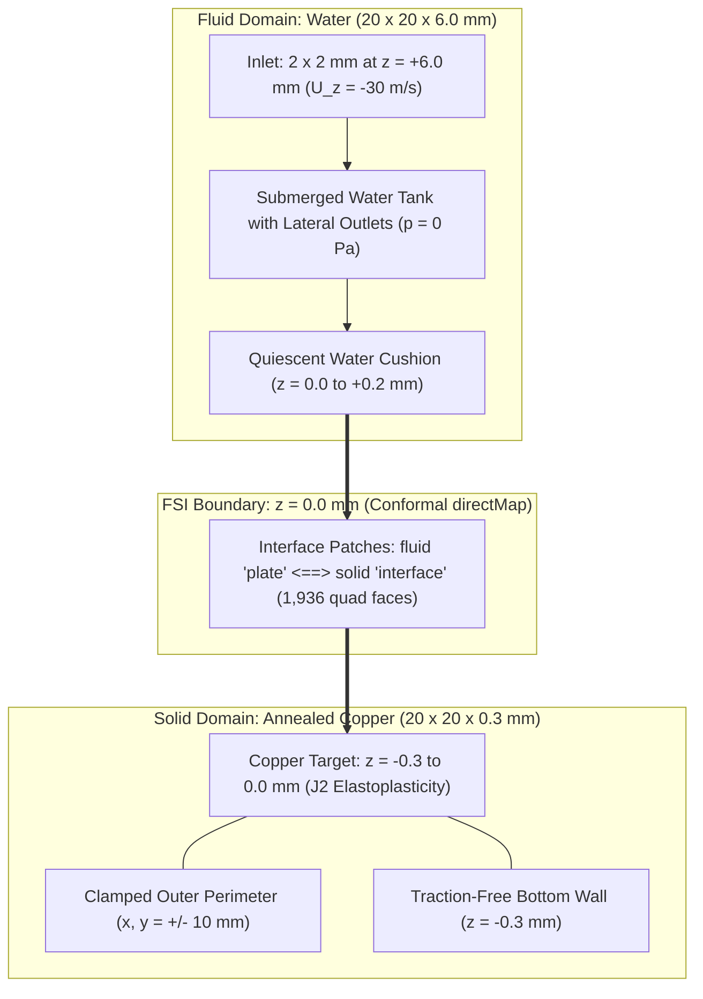

# Submerged Waterjet FSI: Implementation Guide

This document details the complete geometric, mesh, physical, and numerical configuration of the submerged waterjet fluid-structure interaction (FSI) model implemented in `solids4Foam` (OpenFOAM v2412).

---

## 1. Physical Domain & Geometry

The case models a continuous, submerged micro-waterjet impinging at high speed ($U_0 = 30\,\text{m/s}$) upon a clamped thin copper plate. The fluid tank and solid target share a vertical axisymmetric layout:



### Geometric Dimensions

| Component | Dimensions ($L \times W \times H$) | Description |
| :--- | :--- | :--- |
| **Fluid Domain** | $20 \times 20 \times 6.0\,\text{mm}$ | Submerged water tank with lateral open boundaries |
| **Solid Target** | $20 \times 20 \times 0.3\,\text{mm}$ | Annealed copper plate, clamped at outer edges |
| **Nozzle Inflow** | $2 \times 2\,\text{mm}$ (Square footprint) | Centered at $(x, y) = (0, 0)$, $A = 4.0 \times 10^{-6}\,\text{m}^2$ |
| **Initial Cushion**| $0.2\,\text{mm}$ ($z = 0$ to $0.2\,\text{mm}$) | Quiescent water layer mitigating singular initial impact shock |

---

## 2. Conformal Structured Multi-Block Meshing

Both fluid and solid domains are discretized using a structured $3 \times 3$ block topology in the $x$-$y$ plane via `blockMeshDict`.

### In-Plane Topology
- **Central Core** ($-1 \le x, y \le 1\,\text{mm}$): Directly under the nozzle footprint, refined with $16 \times 16$ cells ($\Delta x = \Delta y = 125\,\mu\text{m}$).
- **Outer Perimeter** ($|x|, |y| > 1\,\text{mm}$): Coarser buffer blocks ($14 \times 14$ cells) extending to the lateral boundaries ($\pm 10\,\text{mm}$).
- Total in-plane face count at the interface: $44 \times 44 = 1{,}936$ quad faces.

### Through-Thickness Resolution
- **Solid Plate**: 8 uniform cells across the $0.3\,\text{mm}$ thickness ($\Delta z = 37.5\,\mu\text{m}$). Total solid cells: $1{,}936 \times 8 = 15{,}488$ hexahedra.
- **Fluid Domain**: 24 cells vertically across the $6.0\,\text{mm}$ depth ($\Delta z = 250\,\mu\text{m}$). Total fluid cells: $1{,}936 \times 24 = 46{,}464$ hexahedra.

### 1-to-1 Conformal Interface
Because both `blockMeshDict` files share identical in-plane vertex coordinates and division numbers, patch `plate` (fluid side) and patch `interface` (solid side) match cell-for-cell. This enables exact, non-interpolated `directMap` data transfer across the FSI boundary.

---

## 3. Boundary & Initial Conditions

### Fluid Subdomain (`0/fluid/`)

| Patch | Field `U` | Field `p` | Field `pointMotionU` |
| :--- | :--- | :--- | :--- |
| `inlet` | `fixedValue (0 0 -30)` (or `uniformFixedValue` table) | `zeroGradient` | `fixedValue (0 0 0)` |
| `outlet` | `inletOutlet (0 0 0)` | `fixedValue 0` | `fixedValue (0 0 0)` |
| `topWall` | `fixedValue (0 0 0)` | `zeroGradient` | `fixedValue (0 0 0)` |
| `plate` (FSI) | `movingWallVelocity (0 0 0)` | `zeroGradient` | `fixedValue (0 0 0)` *(dynamically overwritten)* |

> **Crucial ALE Implementation Note**:
> `pointMotionU` on patch `plate` must be declared as `type fixedValue`. Inside `solids4Foam/src/solids4FoamModels/fluidSolidInterfaces/fluidSolidInterface/fluidSolidInterface.C` (lines 1127–1144), the solver executes:
> ```cpp
> refCast<fixedValuePointPatchVectorField>(pointMotionU.boundaryFieldRef()[fluidPatchID])
> ```
> At every FSI sub-iteration, the solver explicitly overrides the patch values with the solid interface velocity $\mathbf{v}_{interface} = (\mathbf{D} - \mathbf{D}_{old}) / \Delta t$. Setting any other boundary condition type causes an immediate runtime exception.

### Fluid Velocity Initialization (`system/fluid/setFieldsDict`)

To ensure smooth solver startup without unphysical shear discontinuities, the initial fluid velocity field is initialized with `boxToCell`:
```openfoam
regions
(
    boxToCell
    {
        box (-0.001001 -0.001001 0.0002) (0.001001 0.001001 0.006001);
        fieldValues
        (
            volVectorFieldValue U (0 0 -30)
        );
    }
);
```
This initializes a square prism of water moving at $30\,\text{m/s}$ downwards from the inlet ($z = 6\,\text{mm}$) down to $z = 0.2\,\text{mm}$, leaving a $0.2\,\text{mm}$ stationary cushion above the plate.

### Solid Subdomain (`0/solid/`)

| Patch | Field `D` (Displacement) | Field `pointD` | Physical Meaning |
| :--- | :--- | :--- | :--- |
| `interface` | `solidTraction` | `fixedValue (0 0 0)` | Receives fluid pressure and shear stress |
| `fixedSides` | `fixedValue (0 0 0)` | `fixedValue (0 0 0)` | Clamped perimeter ($x, y = \pm 10\,\text{mm}$) |
| `bottomWall` | `tractionDisplacement` (zero traction) | `fixedValue (0 0 0)` | Free bottom surface ($z = -0.3\,\text{mm}$) |

---

## 4. Copper Material Constitutive Model

The target is an annealed electrolytic tough pitch (ETP) copper plate modeled via $J_2$ plasticity with isotropic hardening (`linearElasticMisesPlastic`):

```openfoam
mechanical
(
    copper
    {
        type            linearElasticMisesPlastic;
        rho             rho [1 -3 0 0 0 0 0] 8960;
        E               E   [1 -1 -2 0 0 0 0] 110e9;
        nu              nu  [0 0 0 0 0 0 0] 0.34;
        file            "$FOAM_CASE/constant/solid/plasticStrainVsYieldStress";
    }
);
```

### Material Constants

- **Density ($\rho$)**: $8{,}960\,\text{kg/m}^3$
- **Young's Modulus ($E$)**: $110.0\,\text{GPa}$
- **Poisson's Ratio ($\nu$)**: $0.34$
- **Initial Yield Stress ($\sigma_{y0}$)**: $65.0\,\text{MPa}$

### Hardening Curve (`constant/solid/plasticStrainVsYieldStress`)

The yield stress increases monotonically with accumulated equivalent plastic strain $\varepsilon_{p,eq}$:

```openfoam
(
    (0.000000   65.0e+06)
    (0.000500   72.0e+06)
    (0.001000   80.0e+06)
    (0.002000   95.0e+06)
    (0.005000  125.0e+06)
    (0.010000  155.0e+06)
    (0.020000  185.0e+06)
    (0.050000  220.0e+06)
)
```

---

## 5. Execution Workflow & File Directory Structure

The repository structure isolates configuration, scripts, and documentation:

```
waterJet/
├── submergedWaterjetFSI/             # Primary coupled FSI simulation case
│   ├── 0.orig/                      # Clean field backup (avoids mesh resize errors)
│   ├── constant/                    # Physics, turbulence, and FSI properties
│   │   ├── fluid/                   # Fluid transport & turbulence properties
│   │   ├── solid/                   # Copper mechanical properties & hardening curve
│   │   └── fsiProperties            # Coupling method, Aitken parameters, directMap
│   ├── system/                      # Solvers, fvSchemes, fvSolution, controlDict
│   ├── Allrun                       # Meshes, initializes, runs, and plots
│   ├── Allclean                     # Cleans generated timesteps and polyMesh
│   └── plot_results.py              # Generates indentation and force diagnostic plots
├── docs/                            # In-depth technical documentation
│   ├── implementation.md            # Domain, mesh, boundary conditions, copper card
│   ├── numerical-methods.md         # FSI algorithms, Aitken relaxation, pressure physics
│   └── validation.md                # Force analysis, springback vs permanent dent
├── runElasticVsPlasticUnloading.sh   # Automated dynamic unloading benchmark runner
├── compare_elastic_plastic.py       # Comparative script for unloading evaluation
└── README.md                        # Project landing page and quickstart guide
```
