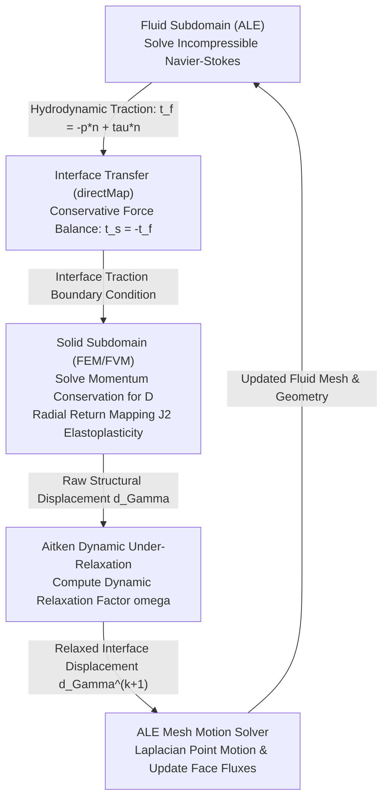

# Submerged Waterjet FSI: Numerical Methods & Theoretical Formulation

This document provides the mathematical foundation and numerical implementation details for the two-way partitioned fluid-structure interaction (FSI) model between a submerged continuous waterjet and an elastoplastic copper plate using `solids4Foam`.

---

## 1. Partitioned FSI Coupling Framework

The coupled fluid-solid system is solved using a partitioned, segregated Dirichlet-Neumann scheme:

At each physical time step $t^{n+1}$:
1. **Fluid Solve**: The incompressible Navier-Stokes equations are solved on the moving mesh yielding pressure $p$ and velocity $\mathbf{U}$.
2. **Traction Transfer**: The fluid boundary traction $\mathbf{t}_f = -p\mathbf{n} + \boldsymbol{\tau} \cdot \mathbf{n}$ is transferred to the solid interface patch as $\mathbf{t}_s = -\mathbf{t}_f$.
3. **Solid Solve**: The solid momentum equation is solved for the displacement field $\mathbf{D}$.
4. **Convergence Check & Aitken Acceleration**: The interface displacement $\mathbf{d}_\Gamma$ is compared against the previous outer iteration. Dynamic under-relaxation updates the interface position.
5. **ALE Mesh Update**: The fluid mesh points are moved using the updated interface boundary condition $\mathbf{v}_{interface} = (\mathbf{D}^{n+1} - \mathbf{D}^n) / \Delta t$, updating cell volumes and face fluxes.

---

## 2. Aitken Dynamic Under-Relaxation

In incompressible FSI problems with dense liquids interacting with thin compliant structures, the ratio of fluid added mass to structural mass is high ($\rho_f / \rho_s \sim 0.11$, but with strong geometric confinement), inducing severe **artificial added-mass instability** in classical loosely-coupled schemes. 

To ensure rapid, robust convergence of the outer coupling loop, `solids4Foam` employs Aitken dynamic under-relaxation:

$$\mathbf{r}^{k+1} = \widetilde{\mathbf{d}}_\Gamma^{k+1} - \mathbf{d}_\Gamma^k$$

where $\widetilde{\mathbf{d}}_\Gamma^{k+1}$ is the raw unrelaxed solid interface displacement from outer iteration $k+1$, and $\mathbf{d}_\Gamma^k$ is the relaxed displacement from iteration $k$.

The dynamic relaxation factor $\omega^{k+1}$ is computed automatically from the change in residuals:

$$\omega^{k+1} = -\omega^k \frac{(\mathbf{r}^k)^T (\mathbf{r}^{k+1} - \mathbf{r}^k)}{\|\mathbf{r}^{k+1} - \mathbf{r}^k\|^2}$$

The relaxed interface displacement is then:

$$\mathbf{d}_\Gamma^{k+1} = \mathbf{d}_\Gamma^k + \omega^{k+1} \mathbf{r}^{k+1}$$

### Coupling Parameters (`constant/fsiProperties`)
- **Outer Correction Tolerance**: $\|\mathbf{r}\|_{L_2} \le 10^{-4}\,\text{m}$
- **Maximum Outer Corrections**: $50$
- **Initial Relaxation Factor**: $\omega_0 = 0.1$
- **Additional Mesh Correction**: `yes` (ensures fluid mesh quality at interface)

---

## 3. Conformal Interface Mapping (`directMap`)

Both the fluid patch `plate` and solid patch `interface` are generated with identical structured $44 \times 44$ grids:
- Number of interface faces: $1{,}936$ on fluid, $1{,}936$ on solid.
- Boundary points align with zero geometric tolerance.

Because the meshes conform 1-to-1:
- `interfaceTransferMethod directMap;` directly copies face values from fluid to solid without spatial interpolation or smoothing.
- This avoids artificial energy dissipation, numerical damping, or interpolation artifacts at the interface.

---

## 4. Arbitrary Lagrangian-Eulerian (ALE) Formulation

To accommodate the deflecting copper plate, the fluid domain equations are solved in the ALE frame:

$$\frac{\partial \mathbf{U}}{\partial t} \Big|_{\boldsymbol{\xi}} + \left((\mathbf{U} - \mathbf{w}) \cdot \nabla\right) \mathbf{U} = -\frac{1}{\rho_f}\nabla p + \nu \nabla^2 \mathbf{U}$$

where $\mathbf{w} = \frac{\partial \mathbf{x}}{\partial t}$ is the fluid grid velocity, and $\boldsymbol{\xi}$ denotes the ALE reference coordinate.

### Geometric Conservation Law (GCL)
The changing cell volumes satisfy the discrete Geometric Conservation Law:

$$\frac{d V_C}{dt} = \sum_f \phi_{mesh, f} = \sum_f \mathbf{w}_f \cdot \mathbf{S}_f$$

where $\mathbf{S}_f$ is the outward-pointing face area vector.

### Mesh Motion Solver
Fluid interior grid points are displaced using a Laplacian smoothing equation with inverse-distance diffusivity:

$$\nabla \cdot \left( \gamma \nabla \mathbf{u}_{mesh} \right) = 0$$

where $\gamma = \frac{1}{d^2}$, and $d$ is the shortest distance to moving boundary patches.

---

## 5. Hydrodynamic Interface Forces: Elliptic Projection vs Incompressible Physics

### Theoretical Steady Jet Momentum Thrust
For a high-speed continuous jet impinging orthogonally against a perpendicular rigid plate, the fluid is deflected radially into a wall jet parallel to the plate. By momentum conservation across a control volume bounding the domain:

$$F_{steady} = \dot{m} U_0 = \rho_f A_{nozzle} U_0^2$$

For our nozzle configuration:
- Fluid density: $\rho_f = 1000\,\text{kg/m}^3$
- Nozzle area: $A_{nozzle} = 2.0\,\text{mm} \times 2.0\,\text{mm} = 4.0 \times 10^{-6}\,\text{m}^2$
- Jet velocity: $U_0 = 30.0\,\text{m/s}$

$$F_{steady} = 1000 \times (4.0 \times 10^{-6}) \times (30.0)^2 = 3.60\,\text{N}$$

*(For a circular jet of equivalent diameter $d = 2\,\text{mm}$, $A = \frac{\pi}{4} d^2 \approx 3.14 \times 10^{-6}\,\text{m}^2 \implies F_{steady} = 2.83\,\text{N}$.)*

### Startup Hydrodynamic Transient
In the early phase of the simulation ($t < 6\,\mu\text{s}$), the interface force significantly exceeds $3.60\,\text{N}$, peaking at $\sim 120 - 150\,\text{N}$. 

#### Why This Occurs: Elliptic Incompressibility
1. **Mathematical Nature**: The fluid solver is incompressible ($\nabla \cdot \mathbf{U} = 0$). The pressure field is governed by an elliptic Poisson equation:
   $$\nabla^2 p = -\rho_f \nabla \cdot (\mathbf{U} \cdot \nabla \mathbf{U})$$
   Because the equation is elliptic, pressure adjustments across the domain are instantaneous (infinite effective sound speed $c \to \infty$).
2. **Deceleration of the Initial Fluid Column**: The fluid within the nozzle region is initialized with downward velocity $U_z = -30\,\text{m/s}$ approaching the plate. Between $z = 0.2\,\text{mm}$ and $z = 0\,\text{mm}$, this downward fluid must rapidly decelerate and turn laterally into a radial wall jet.
3. **Global Patch Integration**: The force monitor integrates over the **entire $20 \times 20\,\text{mm}$ plate patch** ($A_{patch} = 400\,\text{mm}^2$), which is **100 times larger** than the nozzle orifice ($4\,\text{mm}^2$). A transient average pressure of only $\bar{p} \approx 0.35\,\text{MPa}$ integrated over $400\,\text{mm}^2$ produces:
   $$F = \bar{p} \cdot A_{patch} = (0.35 \times 10^6\,\text{Pa}) \times (400 \times 10^{-6}\,\text{m}^2) = 140\,\text{N}$$
4. **Relief via Lateral Outlets**: As fluid spreads laterally along the plate towards the open boundaries ($p = 0\,\text{Pa}$ at $x, y = \pm 10\,\text{mm}$), the global pressure dome collapses. By $t = 8\,\mu\text{s}$, the total interface force drops to $4.79\,\text{N}$, rapidly settling towards the theoretical steady momentum thrust of $3.60\,\text{N}$.

> **Important Theoretical Distinction**: This simulation does NOT model hyperbolic acoustic water-hammer waves ($p_{wh} = \rho c U$). Water hammer requires a compressible formulation ($\frac{\partial \rho}{\partial p} \ne 0$) resolving acoustic wave fronts traveling at $c \approx 1{,}480\,\text{m/s}$. The transient observed here is the purely convective-inertial pressure surge inherent to the incompressible Navier-Stokes projection.

---

## 6. Solid Mechanics & Elastoplastic Constitutive Modeling

### Small-Strain Kinematics
The total strain tensor $\boldsymbol{\varepsilon}$ is decomposed into elastic and plastic components:

$$\boldsymbol{\varepsilon} = \frac{1}{2}\left(\nabla \mathbf{D} + (\nabla \mathbf{D})^T\right) = \boldsymbol{\varepsilon}^e + \boldsymbol{\varepsilon}^p$$

### Hooke's Elasticity
The Cauchy stress tensor $\boldsymbol{\sigma}$ satisfies:

$$\boldsymbol{\sigma} = 2\mu \boldsymbol{\varepsilon}^e + \lambda \text{tr}(\boldsymbol{\varepsilon}^e) \mathbf{I}$$

where the Lamé parameters are:
$$\mu = \frac{E}{2(1 + \nu)} = \frac{110 \times 10^9}{2(1 + 0.34)} \approx 4.104 \times 10^{10}\,\text{Pa}$$
$$\lambda = \frac{E\nu}{(1 + \nu)(1 - 2\nu)} = \frac{110 \times 10^9 \times 0.34}{(1.34)(0.32)} \approx 8.724 \times 10^{10}\,\text{Pa}$$

### von Mises Yield Criterion & Radial Return
Yielding occurs when the equivalent von Mises stress $\sigma_{eq}$ reaches the flow stress $\sigma_y(\varepsilon_{p,eq})$:

$$f(\boldsymbol{\sigma}, \varepsilon_{p,eq}) = \sigma_{eq} - \sigma_y(\varepsilon_{p,eq}) \le 0$$

$$\sigma_{eq} = \sqrt{\frac{3}{2} \mathbf{s} : \mathbf{s}}, \quad \mathbf{s} = \boldsymbol{\sigma} - \frac{1}{3}\text{tr}(\boldsymbol{\sigma})\mathbf{I}$$

Plastic flow follows the associative normality rule:

$$d\boldsymbol{\varepsilon}^p = d\gamma \frac{\partial f}{\partial \boldsymbol{\sigma}} = \frac{3}{2} \frac{\mathbf{s}}{\sigma_{eq}} d\gamma$$

where the plastic consistency parameter $\Delta \gamma$ is solved via the radial return algorithm at each integration point.
