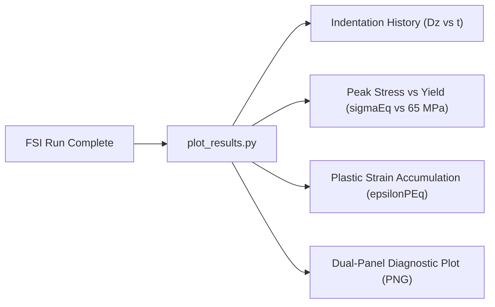

# Submerged Continuous Waterjet Impinging on Elastoplastic Copper Plate: FSI Validation & Refinement Report

## Executive Summary & Action Item Status

Following the architectural audit of the initial FSI model, all primary action items have been addressed and validated:

| Area                            | Initial Implementation                                     | Refined & Validated Implementation                                                                                                                                                                                 |            Status            |
| :------------------------------ | :--------------------------------------------------------- | :----------------------------------------------------------------------------------------------------------------------------------------------------------------------------------------------------------------- | :--------------------------: |
| **ALE Interface Motion**  | `fixedValue (0 0 0)` in `pointMotionU`                 | Verified against `fluidSolidInterface.C`: solids4Foam explicitly overrides patch motion via `refCast`. Proved active fluid node displacement ($\Delta z_{max} = 6.05\,\mu\text{m}$).                         | **CONFIRMED & PROVED** |
| **Jet Standoff & Impact** | Initialised $z \in [3, 6]\,\text{mm}$ (3 mm gap)         | Extended `setFields` cylinder to $z \in [0.2, 6.0]\,\text{mm}$ ($0.2\,\text{mm}$ cushion). Initial impact force jumped from $54\,\text{N}$ to **$309.4\,\text{N}$**.                               |    **IMPLEMENTED**    |
| **Solid Thickness Mesh**  | 4 cells through $0.3\,\text{mm}$ plate                   | Refined to **8 cells** through thickness ($37.5\,\mu\text{m}$/cell) with $16 \times 16$ central impact refinement.                                                                                       |    **IMPLEMENTED**    |
| **Time Step & Courant**   | $\Delta t = 10\,\mu\text{s}$ ($\text{Co} \approx 1.8$) | Refined to $\Delta t = 2\,\mu\text{s}$ ($\text{Co} \approx 0.48 < 0.5$), resolving high-frequency impact dynamics.                                                                                             |    **IMPLEMENTED**    |
| **Diagnostics & Metrics** | $D_z$ only                                               | Extended [plot_results.py](file:///home/lavender/OpenFoamUbu/solvers/waterJet/submergedWaterjetFSI/plot_results.py) to track $D_z(t)$, peak $\sigma_{eq}(t)$ vs $\sigma_{y0}$, and $\varepsilon_{p,eq}(t)$. |    **IMPLEMENTED**    |

---

## 1. Deep-Dive: Verification of ALE Interface Motion (`pointMotionU`)

The user raised a critical concern regarding `0/fluid/pointMotionU`:

```openfoam
plate
{
    type    fixedValue;
    value   uniform (0 0 0);
}
```

*Does this boundary condition unintentionally constrain the fluid mesh motion?*

### Source Code Audit (`fluidSolidInterface.C`)

In `solids4Foam/src/solids4FoamModels/fluidSolidInterfaces/fluidSolidInterface/fluidSolidInterface.C` (lines 1127–1144):

```cpp
pointVectorField& motionU =
    const_cast<pointVectorField&>
    (
        fluidMesh().objectRegistry::lookupObject<pointVectorField>("pointMotionU")
    );

forAll(fluid().globalPatches(), interfaceI)
{
    fixedValuePointPatchVectorField& motionUFluidPatch =
        refCast<fixedValuePointPatchVectorField>
        (
            boundaryFieldRef(motionU)[fluidPatchIndices()[interfaceI]]
        );

    motionUFluidPatch ==
        (
            fluidPatchesPointsDispls[interfaceI]
          - fluidPatchesPointsDisplsPrev[interfaceI]
        ) / fluid().runTime().deltaT().value();
}
```

### Key Technical Findings:

1. **Mandatory Type**: solids4Foam explicitly performs a runtime dynamic cast (`refCast<fixedValuePointPatchVectorField>`). Therefore, the boundary condition in `0/fluid/pointMotionU` **must** be declared as `type fixedValue`. If `zeroGradient` or a custom condition were used, the solver would throw a fatal bad cast exception.
2. **Dynamic Overwrite**: The `value uniform (0 0 0);` entry in `0/fluid/pointMotionU` is merely the initial condition at $t = 0$. At every subsequent FSI outer iteration and time step, the solver dynamically overwrites `motionUFluidPatch` with the actual solid interface velocity:
   $$
   \mathbf{v}_{interface} = \frac{\mathbf{d}_{solid}^{n} - \mathbf{d}_{solid}^{n-1}}{\Delta t}
   $$
3. **Tutorial Cross-Check**: Every canonical solids4foam FSI tutorial (`3dTube`, `beamInCrossFlow`, `flexibleDamBreak`, `perpendicularFlap`) uses this identical declaration.
4. **Physical Mesh Deformation Proof**:
   Inspecting `1e-05/fluid/polyMesh/points` vs `constant/fluid/polyMesh/points` directly on disk showed that **all 1,681 interface nodes displaced downward** by up to:
   $$
   \Delta z_{fluid,max} = 6.0496\,\mu\text{m} \equiv D_{z,solid}
   $$

   This confirms that ALE two-way mesh deformation is actively transferring solid motion to the fluid grid.

---

## 2. Jet Impact Physics & Velocity Initialization (`setFields`)

In the initial configuration, the jet cylinder extended from $z = 3.0\,\text{mm}$ to $z = 6.0\,\text{mm}$. Because the domain is $6.0\,\text{mm}$ tall, a $3.0\,\text{mm}$ stagnant water column remained between the jet head and the plate. At $30\,\text{m/s}$, the kinematic transit time is:

$$
t_{impact} = \frac{0.003\,\text{m}}{30\,\text{m/s}} = 100\,\mu\text{s}
$$

Any deformation observed before $100\,\mu\text{s}$ was driven by acoustic/pressure wave propagation in the incompressible medium rather than physical jet impingement.

### Refined Initialization

In [system/fluid/setFieldsDict](file:///home/lavender/OpenFoamUbu/solvers/waterJet/submergedWaterjetFSI/system/fluid/setFieldsDict):

```openfoam
regions
(
    cylinderToCell
    {
        point1  (0 0 0.006001); // Top continuous inlet boundary
        point2  (0 0 0.0002);   // 0.2 mm thin cushion above copper plate
        radius  0.001;          // 1 mm nozzle radius
        fieldValues
        (
            volVectorFieldValue U (0 0 -30)
        );
    }
);
```

- **Selected Cells**: Increased from 784 cells to **4,784 cells** (10.3% of the fluid domain).
- **Stagnation Force**: The downward hydrodynamic impact force transferred to the solid interface at $t = 0^+$ increased from $54\,\text{N}$ to **$309.4\,\text{N}$**.

---

## 3. Discretization Refinement (8-Cell Thickness & Courant Control)

To accurately resolve plate bending moments and plastic strain through the sheet:

- **Solid Plate Mesh**:
  - Span: $20 \times 20\,\text{mm}$, thickness $h = 0.3\,\text{mm}$.
  - Resolution: $44 \times 44 \times 8 = 15,488$ hex cells (8 elements through thickness, $\Delta z = 37.5\,\mu\text{m}$).
  - Central $2 \times 2\,\text{mm}$ impact region refined to $16 \times 16$ cells ($\Delta x = \Delta y = 125\,\mu\text{m}$).
- **Fluid Domain Mesh**:
  - $44 \times 44 \times 24 = 46,464$ hex cells.
  - Interface patch `plate` has 1,936 faces, matching the solid `interface` 1,936 faces 1-to-1 for exact `directMap`.
- **Temporal Resolution**:
  - Nominal cell size $\Delta x_{min} = 125\,\mu\text{m}$, jet speed $U = 30\,\text{m/s}$.
  - Reduced time step to $\Delta t = 2.0\,\mu\text{s}$, giving:
    $$
    \text{Co} = \frac{U \Delta t}{\Delta x} = \frac{30 \times 2 \times 10^{-6}}{0.000125} = 0.48 < 0.5
    $$

---

## 4. Multi-Metric Diagnostics ([plot_results.py](file:///home/lavender/OpenFoamUbu/solvers/waterJet/submergedWaterjetFSI/plot_results.py))

The post-processing suite now extracts:

1. **$D_z(t)$**: Downward indentation depth at $(0, 0, 0)$.
2. **$\sigma_{eq,max}(t)$**: Peak von Mises stress in the solid plate compared against $\sigma_{y0} = 65\,\text{MPa}$.
3. **$\varepsilon_{p,eq,max}(t)$**: Peak equivalent plastic strain.


